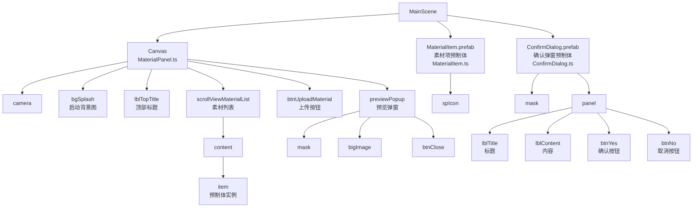
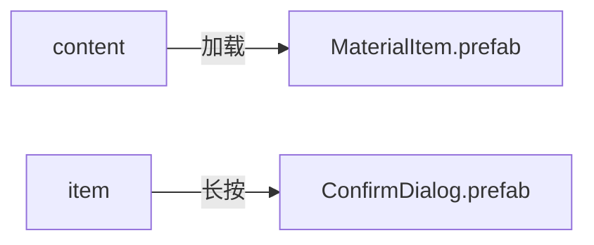
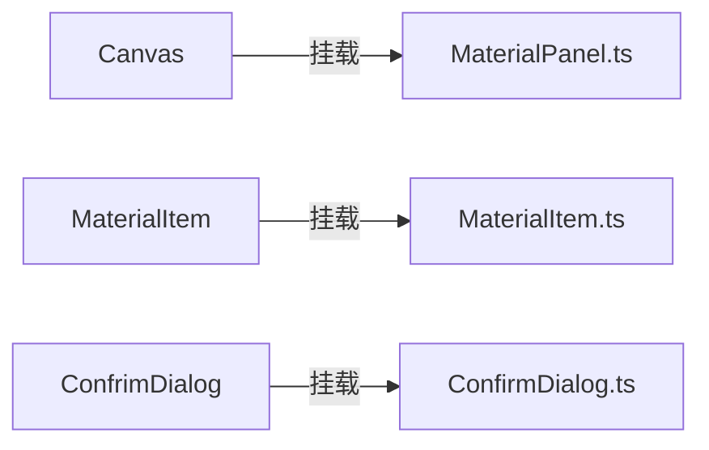
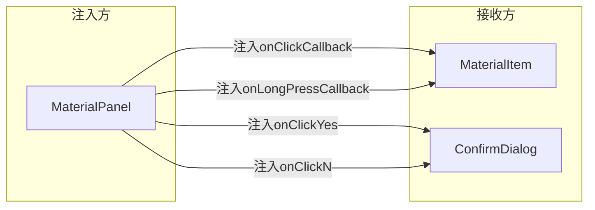
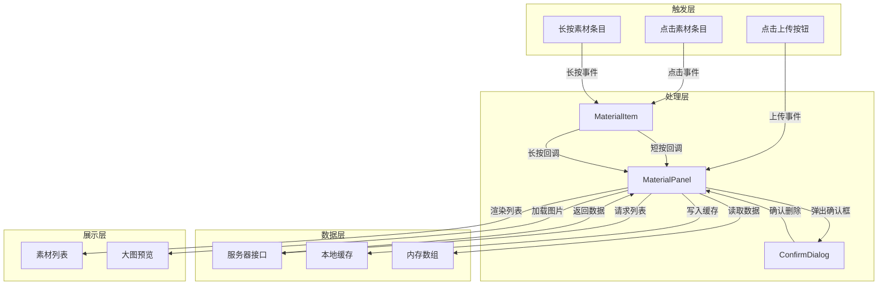

# 素材库 App 项目地图

## 节点结构

## 关系

### 预制体加载关系

### 脚本挂载关系

### 回调注入关系

## 架构总览
触发层：用户通过什么发起操作（点击按钮、点击条目、长按条目等） 
处理层：谁处理时间、做判断和调度（MaterialPanel、MaterialItem、ConfirmDialog) 
数据层：数据从哪里来、存到哪里（服务端接口、本地缓存、内存数组） 
展示层：数据最终呈现给用户（列表、大图预览、弹窗）

## 数据流 - 点击上传

1.用户点击上传按钮 btnUploadMaterial
↓
2.`MaterialPanel.onBtnUploadClick()`模拟上传成功，往数据数组newMaterialPath中添加一个新路径
↓
3.调用`MaterialPanel.addMaterialToData(path)`把新路径加入数据
↓
4.调用`MaterialPanel.refreshListView()`刷新界面：
    a.清空 content 下所有子节点（removeAllChildren）
    b.遍历数据列表，逐个实例化Item
        - 实例化
        - 获取Item上的 MaterialItem 脚本(getComponent(MaterialItem))
        - 依次注入：
            - setMaterial(path)     加载并显示图片
            - setIndex(i)       设置索引
            - setPath(path)     保存路径到成员变量
            - setClickCallback(this.onItemClick.bind(this))      注入点击回调
            - setLongPressCallback(this.onItemLongPress.bind(this))      注入长按回调
        - 把Item加入 content(contentNode.addChild(newItem))

## 数据流 - 点击图片预览大图
1.用户点击（短按）图片item  
↓
2.调用 `MaterialItem.onTouchEnd` 判断是短按 
    // 细节： `onTouchStart` 记录时间 → `onTouchEnd` 计算时长 → 判断是否 < 0.8
↓
3.调用 `MaterialItem.onClickCallback`
↓
3.5 执行 `onClickCallback` 里存的“任务包”（也就是 `itemComp.setClickCallback(this.showPreview.bind(this));` 打包的这个）
↓
4.执行注入的`MaterialPanel.showPreview(path)`
    -设置bigImageSprite图片背景
    -设置previewPopup弹窗可见

## 数据流 - 长按删除
1.用户长按图片 item
↓
2.调用`MaterialItem.onTouchStart`启动长按计时器（800ms），定时器超时，触发长按
↓
3.调用`MaterialItem.onLongPressCallback`
↓
3.5 执行`onLongPressCallback`里存的函数，也就是`itemComp.setLongPressCallback(this.onItemLongPress.bind(this));`
↓
4.执行注入的`MaterialPanel.onItemLongPress(index)`
    - 调用`ConfirmDialog.open`打开弹窗
    - 注入 `onClickYes = deleteMaterial.bind(this, index)` 
    - 注入 `onClickNo = closeDialog.bind(this)`
↓
6.点击确认
↓
6.5 `ConfirmDialog` 执行 `onClickYes` 回调
↓
7.执行`MaterialPanel.deleteMaterial(index)`
    - 删除素材
    - 调用`MaterialPanel.refreshListView()`刷新列表
↓
8. `ConfirmDialog` 关闭弹窗
    // 细节：先执行 `onClickYes`回调，再Close自己

（如果用户点击取消）
6'. 用户点击取消
↓
6.5' `ConfirmDialog` 执行 `onClickNo` 回调
    - 关闭弹窗

